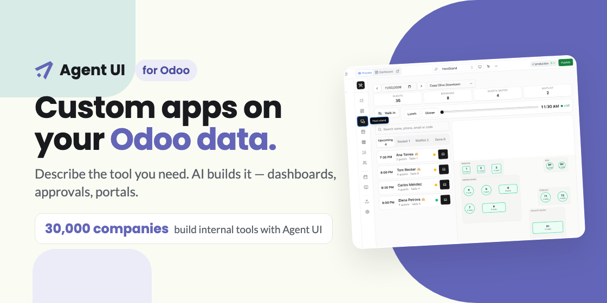

# AI App Builder for Odoo | AgentUI

**Build custom apps, dashboards, customer portals and AI agents on your Odoo data. Describe what you need and AgentUI builds it. No code.**

[](https://apps.odoo.com/apps/modules/18.0/agentui_connector)


👉 **Install it from the Odoo Apps Store: [apps.odoo.com/apps/modules/18.0/agentui_connector](https://apps.odoo.com/apps/modules/18.0/agentui_connector)**



## What you can build on Odoo

- **Custom Odoo dashboards and reports**: sales, invoices, inventory and CRM pipeline in one screen.
- **Odoo customer and supplier portals**: clients see their orders and invoices without an Odoo user.
- **Approval flows and internal tools**: quotes, purchase approvals, field service forms, checklists.
- **AI agents for Odoo** that read and write records: create leads, look up customers, prepare sales orders.
- **Mobile apps for your team**: warehouse, sales reps and technicians on their phone.

## Works with your Odoo data

AgentUI connects through the standard Odoo external API (XML-RPC) with your URL, database, user and an Odoo API key.

| Odoo data | What AgentUI can do |
| --- | --- |
| Customers and contacts | Read, create, update |
| Sales orders | Read, create, confirm |
| Invoices, products, inventory | Read |
| CRM leads | Read, create |
| Sales and inventory reports | Read |
| Any other Odoo model | Whatever the connected user can access |

Your Odoo access rules still apply: AgentUI only sees what the connected user can see.

## How it works

1. Install the **AgentUI** module from the [Odoo Apps Store](https://apps.odoo.com/apps/modules/18.0/agentui_connector). A new **AgentUI** menu appears in Odoo.
2. Click **Open AgentUI** and connect Odoo with the values shown on screen.
3. Describe the app you need. AgentUI builds it on your Odoo data.
4. Paste the app link in **Settings > AgentUI**. Your team opens it from the Odoo menu.

## Compatibility

- Odoo 18 Community and Enterprise
- Odoo.sh and on-premise. Standard Odoo Online (SaaS) does not allow third-party modules.
- Requires an AgentUI account: [agentui.ai](https://agentui.ai)

## Manual install

```bash
git clone -b 18.0 https://github.com/agentui-ai/agentui-odoo.git
# add the folder to your Odoo addons_path, update the app list, then install "AgentUI"
```

## Repository layout

One branch per Odoo version (`18.0`, ...). `agentui_connector/` is the Odoo module (menu, client action, settings).

## Crea apps con IA sobre tus datos de Odoo

Dashboards, portales de clientes, aprobaciones y agentes de IA conectados a Odoo. Describe la app que necesitas y AgentUI la construye sobre tus clientes, pedidos de venta, facturas, productos e inventario. Sin programar. Instálalo desde la [Odoo Apps Store](https://apps.odoo.com/apps/modules/18.0/agentui_connector).

## License

LGPL-3
